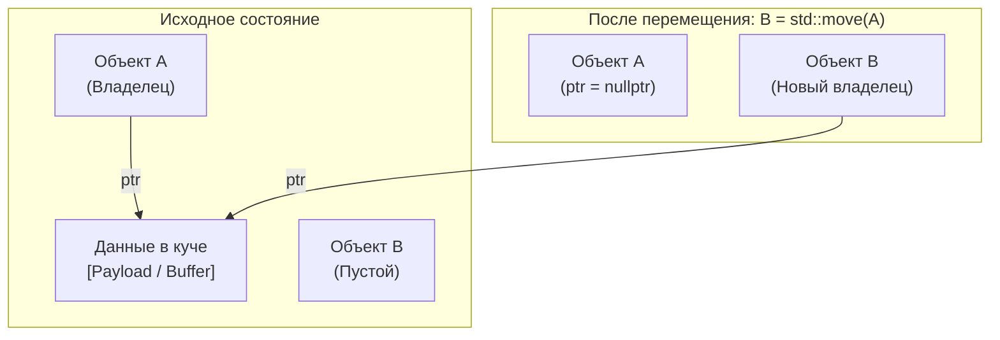

# 🌐 Семантика перемещения (Move Semantics)

## 📌 Суть темы
> **Семантика перемещения (Move Semantics)** — механизм языка C++11, позволяющий передавать владение динамическими ресурсами (память в куче, файловые и сетевые дескрипторы) от одного объекта к другому без дорогостоящего глубокого копирования за счёт «кражи» внутренних указателей у временных объектов.

---

## 🧠 Семантика владения и Характеристики памяти
**Связанные темы:** 
  [[RAII]], 
  [[unique_ptr]], 
  [[Rule_of_Five]], 
  [[perfect_forwarding]], 
  [[std_move]]
  
**Категории значений (Value Categories):**
  - **`lvalue`** (left value) — именованный объект, занимающий идентифицируемое место в памяти (можно взять адрес `&`), .
  - **`rvalue`** (right value, в некоторых источниках фигурируют ещё две подкатегории: *xvalue*, *prvalue*) — временный объект или литерал (значение, написанное прямо в исходном коде программы), подлежащий перемещению или уничтожению.
**Rvalue-ссылка (`T&&`):** Синтаксис, связывающийся исключительно с временными объектами (*rvalues*), сигнализируя компилятору о возможности забрать ресурсы.
**Оверхед (Performance):** Перемещение сводится к копированию нескольких примитивных полей (указатель, `size`, `capacity`) и обнулению источника ($O(1)$ вместо $O(N)$ глубокого копирования).

### 🔄 Потоковая модель и Безопасность
- **Исключения и `noexcept`:** Перемещающие конструкторы и операторы присваивания **критически важно** помечать спецификатором `noexcept`. Если `noexcept` отсутствует, стандартные контейнеры (например, `std::vector::push_back` при реаллокации) откажутся от перемещения и применят медленное копирование ради гарантии строгой безопасности исключений (Strong Exception Safety).



---

## 💻 Сигнатуры и Код (MRE)
*Реализация класса с перемещающим конструктором и оператором присваивания (Правило пяти):*

```cpp
#include <iostream>
#include <utility>
#include <cstring>

class DynamicBuffer {
    char* data_{nullptr};
    std::size_t size_{0};

public:
    DynamicBuffer(const char* str) {
        if (str) {
            size_ = std::strlen(str);
            data_ = new char[size_ + 1];
            std::memcpy(data_, str, size_ + 1);
        }
    }

    ~DynamicBuffer() {
        delete[] data_;
    }

    // 1. Конструктор перемещения (Move Constructor)
    DynamicBuffer(DynamicBuffer&& other) noexcept
        : data_(std::exchange(other.data_, nullptr)), // Крадем указатель и обнуляем у other
          size_(std::exchange(other.size_, 0)) {
    }

    // 2. Перемещающий оператор присваивания (Move Assignment)
    DynamicBuffer& operator=(DynamicBuffer&& other) noexcept {
        if (this != &other) {
            delete[] data_; // Освобождаем свой старый ресурс

            data_ = std::exchange(other.data_, nullptr);
            size_ = std::exchange(other.size_, 0);
        }
        return *this;
    }

    // Запрет / реализация копирования
    DynamicBuffer(const DynamicBuffer&) = delete;
    DynamicBuffer& operator=(const DynamicBuffer&) = delete;
};

int main() {
    DynamicBuffer buf1("Large Data Payload");

    // std::move выполняет только static_cast к rvalue-ссылке (T&&),
    // он сам ничего не перемещает!
    DynamicBuffer buf2 = std::move(buf1); 

    DynamicBuffer buf3("Another Buffer");
    buf3 = std::move(buf2);

    return 0;
}
```

### 📋 Важные функции, примитивы и правила
- **`std::move(x)`:** Приведение аргумента к rvalue-ссылке: `static_cast<std::remove_reference_t<T>&&>(x)`.
- **`std::exchange(obj, new_val)`:** Удобная утилита для присваивания нового значения переменной с возвратом её предыдущего значения (идеальна для обнуления полей при перемещении).
- **Именованная rvalue-ссылка внутри функции — это lvalue:**
  ```cpp
  void process(Widget&& w) {
      // w имеет тип rvalue-ссылки, но сама переменная 'w' — это lvalue
      // Чтобы передать её дальше как rvalue, нужен повторный std::move
      other_func(std::move(w));
  }
  ```

---

## ⚠️ Подводные камни и Управление памятью (Gotchas)
- **Использование объекта после перемещения (Use-After-Move):**
  Стандарт гарантирует, что перемещённый объект остаётся в «валидном, но неопределенном состоянии». Его можно безопасно уничтожить (`~T()`) или присвоить ему новое значение, но читать из него данные нельзя (это путь к UB или пустым значениям).
- **`const` блокирует перемещение:**
  ```cpp
  const std::string text = "Heavy String";
  std::string target = std::move(text); 
  // Произойдет КОПИРОВАНИЕ, а не перемещение!
  // Причина: тип const std::string&& не может привязаться к std::string&&, 
  // но идеально подходит к const std::string& (конструктор копирования).
  ```
- ** 'Пессимизация' возврата из функций (`std::move` в `return`):**
  ```cpp
  std::string make_string() {
      std::string s = "Hello";
      return std::move(s); // Отключает NRVO / RVO (Copy Elision) оптимизации.
      // Правильно: return s; (компилятор сам всё сделает).
  }
  ```
- **Забытый `noexcept`:** Если конструктор перемещения не помечен как `noexcept`, `std::vector` при превышении вместимости (`capacity`) будет вызывать конструкторы копирования для всех элементов массива.

---

## ⚙️️ Практические сценарии (Use Cases)
- [x] **Move-only типы:** Типы, которые принципиально не могут быть скопированы: `std::unique_ptr`, `std::jthread`, `boost::asio::ip::tcp::socket`.
- [x] **Sink-параметры (утекающие параметры):** Приём объектов по значению в конструктор с последующим перемещением в поле класса (`T(std::string s) : s_(std::move(s)) {}`).

---

## 🔗 Источники и Референсы
- 📖 [cppreference: Value categories](https://en.cppreference.com/w/cpp/language/value_category)
- 📖 [cppreference: Move constructors](https://en.cppreference.com/w/cpp/language/move_constructor)
- 📖 [cppreference: std::move](https://en.cppreference.com/w/cpp/utility/move)
- 🗺️ Карта знаний: [[MOC_C++_Memory_Management]]