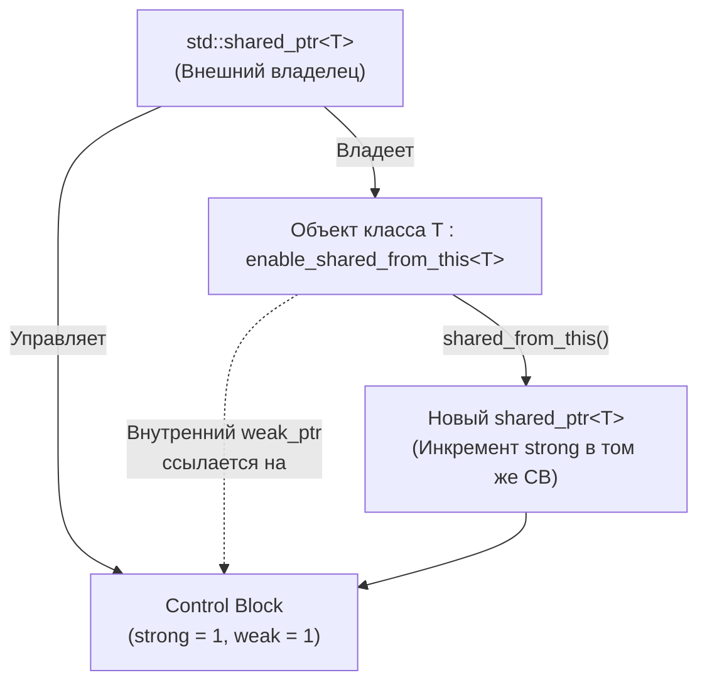

# 🌐 enable_shared_from_this

> [!abstract] Суть темы
> `std::enable_shared_from_this<T>` — вспомогательный базовый класс, который позволяет объекту безопасно создавать новые экземпляры `std::shared_ptr<T>`, ссылающиеся на самого себя, разделяя существующий контрольный блок владения.

---

## 🧠 Семантика владения и Характеристики памяти
**Связанные темы:** 
[[shared_ptr]], 
[[weak_ptr]],
[[RAII]]

**Модель владения:** 
Хранит внутри приватное невладeющее поле `std::weak_ptr<T>`, привязываемое к контрольному блоку при первом создании внешнего `std::shared_ptr`.

**Оверхед по памяти и производительности:**
- Размер внутри объекта: ровно размер одного `std::weak_ptr` (обычно `2 * sizeof(void*)`)
- Вызов `shared_from_this()`: эквивалентен вызову `.lock()` у скрытого слабого указателя (атомарный инкремент сильного счетчика `use_count++`)

### 🔄 Потоковая модель и Безопасность
- **Потокобезопасность вызова:** 
  Вызов `shared_from_this()` потокобезопасен и может выполняться параллельно из разных потоков при условии, что сам объект уже полностью сконструирован и управляется хотя бы одним `std::shared_ptr`.
- **Инициализация поля `weak_ptr`:** 
  Выполняется не в конструкторе класса, а внутри конструктора `std::shared_ptr<T>(T*)` или `std::make_shared<T>()`.



---

## 💻 Сигнатуры и Код (MRE)
*Минимальный рабочий пример (Minimal Reproducible Example):*

### Если объект обязан управляться через std::shared_ptr
```cpp
//Если объект обязан управляться через std::shared_ptr, то наследование от std::enable_shared_from_this - это стандартный и самый безопасный путь.
#include <memory>
#include <iostream>

class Session : public std::enable_shared_from_this<Session> {
private:
    Session() { std::cout << "Session started" << std::endl; }

public:
    // Создавать объект можно только через shared_ptr
    static std::shared_ptr<Session> create() {
        // Обычный std::make_shared не сработает с приватным конструктором в старых стандартах, 
        // поэтому используем struct-helper или обычный new:
        return std::shared_ptr<Session>(new Session());
    }

    void runAsynchronousTask() {
        auto self = shared_from_this();
        std::cout << "References: " << self.use_count() << std::endl; // 2
    }
};

int main() {
    // Создать Session на стеке теперь невозможно - будет ошибка компиляции
    auto session = Session::create();
    session->runAsynchronousTask();
}
```

### Переход на сырой указатель или reference_wrapper (Если объект точно живет дольше)
```cpp
//Переход на сырой указатель или reference_wrapper (Если объект точно живет дольше)
#include <iostream>

struct EventListener {
    void onEvent() { std::cout << "Event received" << std::endl; }
};

class EventManager {
    EventListener* listener_ = nullptr; // Не владеет объектом, просто знает о нем
public:
    void registerListener(EventListener* listener) { listener_ = listener; }
    void fire() { if (listener_) listener_->onEvent(); }
};

class Application : public EventListener {
    EventManager manager;
public:
    void setup() {
        // Абсолютно безопасно передать `this` как сырой указатель, 
        // так как manager уничтожится вместе с Application (объект точно жив)
        manager.registerListener(this); 
    }
};
```

### Передача std::weak_ptr извне (Если нельзя наследоваться)
```cpp
//Передача std::weak_ptr извне (Если нельзя наследоваться)
#include <memory>

class Widget {
private:
    std::weak_ptr<Widget> self_weak; // Cлабая ссылка внутри

public:
    void setWeakRef(std::weak_ptr<Widget> weak) {
        self_weak = weak;
    }

    void doSomething() {
        // Пытаемся получить shared_ptr, когда это необходимо
        if (auto self = self_weak.lock()) {
            // Объект жив, можно безопасно работать через self
        }
    }
};

int main() {
    auto widget = std::make_shared<Widget>();
    widget->setWeakRef(widget); // Передаем ссылку вручную сразу после создания
    widget->doSomething();
}
```
### 📋 Важные функции, методы и параметры
- **`shared_from_this()`:** Возвращает экземпляр `std::shared_ptr<T>`, делящий владение с другими существующими владельцами. Если объект не управляется `std::shared_ptr`, генерирует исключение `std::bad_weak_ptr`.
- **`weak_from_this()` (начиная с C++17):** Возвращает `std::weak_ptr<T>`. Удобно, если вызывающему объекту не нужно форсировать сильное владение, а требуется лишь слабая ссылка для проверки жизнеспособности.
---

## ⚠️ Подводные камни и Управление памятью (Gotchas)
- **Вызов внутри конструктора (Классический краш):**
  ```cpp
  struct Bad : std::enable_shared_from_this<Bad> {
      Bad() {
          //!!!std::bad_weak_ptr!!!
          auto self = shared_from_this(); 
      }
  };
  // Причина: конструктор shared_ptr еще не закончил работу, 
  // внутренний weak_ptr еще не инициализирован.
  ```
  > **Решение:** Вызывать `shared_from_this()` только в обычных методах или использовать фабричный статический метод `create()` с двухфазной инициализацией.
- **Создание объекта на стеке:**
  ```cpp
  Bad b;
  b.shared_from_this(); // Исключение std::bad_weak_ptr (объект на стеке)
  ```
- **Приватное наследование:** Наследование `class Worker : std::enable_shared_from_this<Worker>` по умолчанию делает базовый класс приватным. `std::shared_ptr` не сможет получить доступ к внутреннему слабому указателю. Наследование обязано быть **`public`**.
- **Катастрофа `std::shared_ptr<T>(this)` вместо `shared_from_this()`:**
  Если вместо `shared_from_this()` написать `std::shared_ptr<T>(this)`, будет создан **второй независимый Control Block**, что приведет к немедленному `double free` при удалении.
---

## ⚙️️ Практические сценарии (Use Cases)
- [x] **Паттерн `self = shared_from_this()` в Boost.Asio:** Захват сессии в лямбду асинхронного чтения/записи сокета (`async_read`/`async_write`), чтобы сокет и буфер не удалились до возврата из системного вызова.
- [x] **Ивент-системы и наблюдатели:** Регистрация объекта в диспетчере событий, когда слушатель должен сам передать ссылку на себя.
- [x] **Цепочечные вызовы :** Возврат `shared_ptr` на самого себя для построения цепочек методов.

---

## 🔗 Источники и Референсы
- 📖 [cppreference: std::enable_shared_from_this](https://en.cppreference.com/w/cpp/memory/enable_shared_from_this)
- 📖 [cppreference: std::bad_weak_ptr](https://en.cppreference.com/w/cpp/memory/bad_weak_ptr)
- 🗺️ Карта знаний: [[MOC_C++_Memory_Management]]