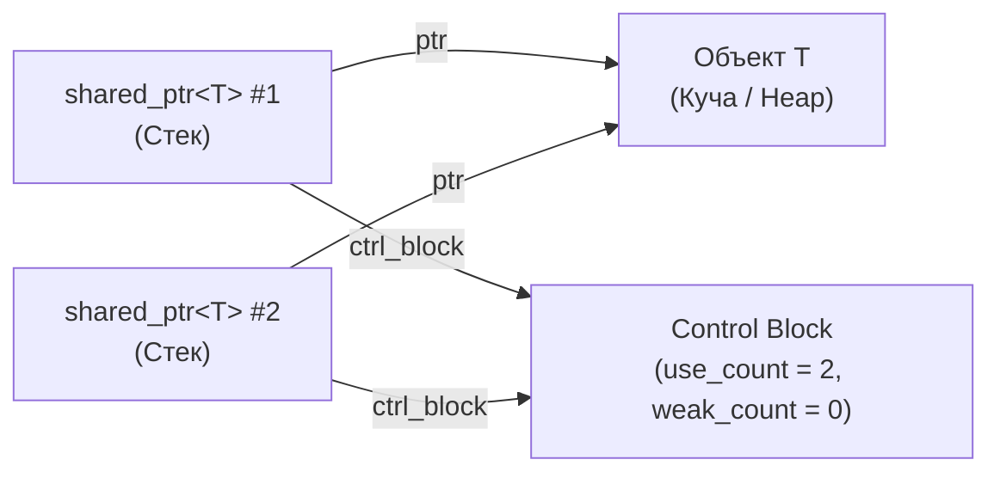

# 🌐 shared_ptr

> [!abstract] Суть темы
> `std::shared_ptr` — умный указатель, реализующий модель **разделяемого (совместного) владения** динамическим ресурсом с подсчётом ссылок. Объект уничтожается автоматически, когда счетчик сильных ссылок падает до нуля.

---

## 🧠 Семантика владения и Характеристики памяти
**Связанные темы:** 
- [[RAII]], 
- [[move_semantics]], 
- [[custom_deleters]], 
- [[unique_ptr]], 
- [[pimpl_idiom]]
- [[enable_shared_from_this]]
  
**Модель владения:** `Разделяемое`
 **Копирование и Перемещение:**
  - Копирование: `Разрешено (инкремент счетчика сильных ссылок)`
  - Перемещение: `С обнулением исходного указателя`

**Оверхед по памяти и производительности:**
 - Размер на стеке: Двойной указатель (`2 * sizeof(void*)`)]: указатель на управляемый объект + указатель на контрольный блок (Control Block).
 - Контрольный блок в куче: содержит `strong_refs` (`atomic`), `weak_refs` (`atomic`), кастомный `deleter` и аллокатор.
 - Атомарные операции: инкремент/декремент счетчика выполняется через межпоточные атомики, что создает вычислительный оверхед по сравнению с `unique_ptr`.

### 🔄 Потоковая модель и Безопасность
- **Счетчик ссылок:** 
  Потокобезопасен (из-за наличия std::atomic). Инкремент и декремент из разных потоков не вызывают гонку данных.
- **Управляемый объект (`T`):** 
  **НЕ защищен.** Параллельная запись в поля объекта через разные `shared_ptr` требует внешней синхронизации.
- **Сам экземпляр указателя:** 
  Параллельное переприсваивание одного и того же объекта `shared_ptr` без внешней блокировки (или `std::atomic<std::shared_ptr<T>>`) приводит к Data Race.



---

## 💻 Сигнатуры и Код (MRE)
*Минимальный рабочий пример (Minimal Reproducible Example):*

```cpp
#include <iostream>
#include <memory>
#include <vector>

struct Node {
    int value;
    Node(int v) : value(v) { std::cout << "Node " << value << " создан\n"; }
    ~Node() { std::cout << "Node " << value << " уничтожен\n"; }
};

void observer(std::shared_ptr<Node> p) {
    std::cout << "[Внутри функции] use_count: " << p.use_count() << '\n';
} // p выходит из области видимости -> use_count--

int main() {
    // 1. Предпочтительный способ создания: std::make_shared (одна аллокация памяти)
    auto ptr1 = std::make_shared<Node>(100);
    std::cout << "Создан ptr1, use_count: " << ptr1.use_count() << '\n'; // 1

    {
        // 2. Копирование увеличивает счетчик владельцев
        auto ptr2 = ptr1;
        std::cout << "Скопирован ptr2, use_count: " << ptr1.use_count() << '\n'; 

        observer(ptr2); // Внутри функции use_count станет 3
        std::cout << "После возврата из функции use_count() вернёт 2: " << ptr1.use_count() << '\n'; 
    } // ptr2 уничтожается здесь -> use_count-- (снова 1)

    std::cout << "Блок закрыт, use_count: " << ptr1.use_count() << '\n'; // 1

    // 3. Перемещение не трогает атомарный счетчик
    auto ptr3 = std::move(ptr1);
    // ptr1 теперь nullptr, счетчик по-прежнему 1
    std::cout << "После std::move: ptr1 = " << (ptr1 ? "not null" : "nullptr")
              << ", ptr3 use_count: " << ptr3.use_count() << '\n';

    return 0;
} // ptr3 выходит из видимости -> use_count = 0 -> delete объекта и контрольного блока
```

### 📋 Важные функции, методы и параметры
- **`std::make_shared<T>(args...)`:** Выделяет память под объект `T` и контрольный блок **единым непрерывным куском** (1 аллокация вместо 2, кэш-дружественно, процессор кайфует от этой прикормки).
- **`use_count()`:** Возвращает текущее число владельцев (сильных ссылок). Бывает полезно, но чаще используется для отладки.
- **`get()`:** Возвращает сырой указатель `T*`.
- **`reset()`:** Уменьшает счетчик ссылок текущего объекта (при необходимости уничтожая его) и обнуляет указатель.
- **Кастомный делитор (`Deleter`):** В отличие от `unique_ptr`, тип делитора **стирается** (Type Erasure) и не входит в тип `std::shared_ptr<T>`, а сохраняется внутри контрольного блока:
  ```cpp
  // Тип указателя остается просто std::shared_ptr<FILE>, а не шаблон с непонятной лямбдой внутри
  //Пример обёртки для Си-шного файла
  std::shared_ptr<FILE> file(fopen("log.txt", "w"), [](FILE* f) { if (f) fclose(f); });
  ```

---

## ⚠️ Подводные камни и Управление памятью (Gotchas)
- **Циклические ссылки (Circular Dependency Memory Leak):**
  Если Объект А содержит `shared_ptr` на Объект Б, а Объект Б содержит `shared_ptr` на Объект А, их счетчики никогда не упадут до 0. Возникает классическая утечка памяти.
  > **Решение:** Один из указателей обязан быть невладеющим: [[weak_ptr]].
- **Создание из одного сырого указателя дважды:**
  ```cpp
  Node* raw = new Node(1);
  std::shared_ptr<Node> p1(raw); // Создаст Control Block #1
  std::shared_ptr<Node> p2(raw); // Создаст Control Block #2! Double delete!
  ```
- **Обратная сторона `std::make_shared` (Задержка освобождения памяти):**
  Поскольку объект и контрольный блок находятся в одном блоке памяти, если на объект останется хотя бы один «живой» `std::weak_ptr`, деструктор объекта `~T()` вызовется вовремя, но **вся выделенная память не вернется в систему**, пока живы слабые ссылки.
- **Потеря `this` при обратном получении: [[enable_shared_from_this]]**
  Нельзя создавать `std::shared_ptr<T>(this)` внутри методов класса. Необходимо наследоваться от `std::enable_shared_from_this<T>` и вызывать `shared_from_this()`.

---

## ⚙️️ Практические сценарии (Use Cases)
- [x] **Асинхронные сессии в Boost.Asio:** Удержание сетевой сессии в живых до завершения последнего колбэка (`enable_shared_from_this`).
- [x] **Разделяемые кэши / Read-heavy структуры:** Множественные потоки-читатели удерживают ссылки на кэшированные объекты.
- [x] **Графовые структуры:** Узлы ациклических ориентированных графов со множественными входящими ребрами.

---

## 🔗 Источники и Референсы
- 📖 [cppreference: std::shared_ptr](https://en.cppreference.com/w/cpp/memory/shared_ptr)
- 📖 [cppreference: std::make_shared](https://en.cppreference.com/w/cpp/memory/shared_ptr/make_shared)
- 🗺️ Карта знаний: [[MOC_C++_Memory_Management]]