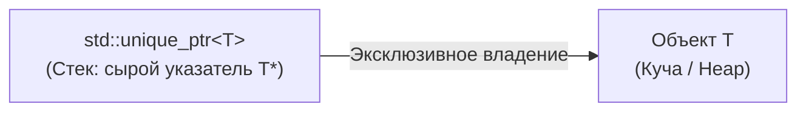

# 🌐 unique_ptr

> [!abstract] Суть темы
> `std::unique_ptr` — умный указатель, реализующий модель **строгого эксклюзивного владения** динамическим ресурсом. Гарантирует автоматическое освобождение памяти при выходе из области видимости (RAII) и запрещает дублирование указателя (путём запрета копирования).

---

## 🧠 Семантика владения и Характеристики памяти
**Связанные темы:** 
  - [[RAII]], 
  - [[move_semantics]], 
  - [[custom_deleters]], 
  - [[shared_ptr]], 
  - [[pimpl_idiom]]
  
**Модель владения:** `Эксклюзивное`
**Копирование и Перемещение:**
  - Копирование: `Запрещено`
  - Перемещение:  `С обнулением исходного указателя`

- **Оверхед по памяти и производительности:**
  - Размер на стеке: `zero-overhead (sizeof(T*))`
  - Дополнительные аллокации:  `Нет`

### 🔄 Потоковая модель и Безопасность
- **Потокобезопасность самого указателя:** Передача одного объекта `unique_ptr` между потоками без внешней синхронизации (например, мьютексов) приводит к гонке данных.



---

## 💻 Сигнатуры и Код (MRE)
### Минимальный рабочий пример (Minimal Reproducible Example):

```cpp
#include <iostream>
#include <memory>
#include <utility>

struct Widget {
    int id;
    Widget(int id) : id(id) { std::cout << "Widget " << id << " created" << std::endl; }
    ~Widget() { std::cout << "Widget " << id << " destroyed" << std::endl; }
    void render() const { std::cout << "Rendering widget " << id << std::endl; }
};

// Функция забирает владение ресурсом на себя (Sink Parameter)
void process_widget(std::unique_ptr<Widget> w) {
    if (w) {
        w->render();
    }
} // объект уничтожается

int main() {
    // std::make_unique (C++14)
    auto w1 = std::make_unique<Widget>(42);

    w1->render();
    (*w1).render();

    // 3. Передача владения (Move Semantics)
    // process_widget(w1);            // копирование не
    process_widget(std::move(w1));     // ОК: w1 отдает владение

    // Теперь w1 пуст (nullptr)
    if (!w1) {
        std::cout << "w1 теперь пуст" << std::endl;
    }

    // 4. Специализация для динамических массивов (C++11)
    auto arr = std::make_unique<int[]>(5);
    arr[0] = 10; // Поддерживает operator[]

    return 0;
}
```

### 📋 Важные функции, методы и параметры
- **Фабричная функция (`std::make_*`):** Плюсы использования против прямого `new` (исключительная безопасность, объединение аллокаций).
- **`get()`:** Получение сырого указателя `T*`. Правило: никогда не удалять и не передавать в другой умный указатель.
- **`reset()` / `release()`:** Разница между немедленным уничтожением ресурса и отказом от владения без вызова деструктора.
- **Кастомный делитор (Deleter):** Способ передачи кастомного освобождения (`fclose`, `free`, лямбда) и его влияние на тип указателя.

---

## ⚠️ Подводные камни и Управление памятью (Gotchas)
- **Множественные независимые владельцы:** 
  Создание двух умных указателей из одного сырого адреса `T*` приводит к двойному освобождению памяти (`double free`).
- **Разыменование после перемещения (Use-After-Move):** 
  Обращение к объекту через `operator->` после `std::move` приводит к разыменованию `nullptr`.
- **Неполные типы (Incomplete Types) и Pimpl:** 
  Для типов вроде `std::unique_ptr` деструктор объемлющего класса обязан быть определен в `.cpp`, где тип `T` полностью известен.

---

## ⚙️️ Практические сценарии (Use Cases)
- [ ] Передача ресурса в функцию по значению (Sink-параметр для забора владения).
- [ ] Фабричный метод (возврат созданного ресурса из функции).
- [ ] Оборачивание Си-библиотек и системных дескрипторов (деструкторы сокетов, файлов `FILE*`).
- [ ] Реализация идиомы Pimpl (Pointer to Implementation).

---

## 🔗 Источники и Референсы
- 📖 [cppreference: Без названия](https://en.cppreference.com/)
- 🗺️ Карта знаний: [[MOC_C++_Memory_Management]]