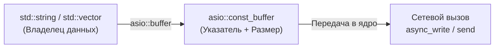

# 🌐 Буферы и управление памятью в asio 

> [!abstract] Суть темы
>`boost::asio::buffer` - это легковесная обёртка-представление (non-owning view, аналог span), хранящая только сырой указатель на непрерывную область памяти и её размер в байтах. Asio **никогда не копирует данные буфера себе** и **не управляет временем их жизни**.

---

## 🧠 Ключевые концепции и Жизненный цикл
*Связанные темы:* 
- [[const_buffer]],
- [[mutable_buffer]],
- [[dynamic_buffer]],
- [[streambuf]],

**Роль в архитектуре:** 
Обеспечивает концепцию Zero-Copy при передаче данных между пользовательским кодом и системными вызовами ядра ОС (`read`, `write`, `recv`, `send`).

### 🔄 Потоковая модель и Контекст выполнения
**Время жизни:** Критически важно гарантировать, чтобы исходный контейнер не был перемещён, реаллоцирован или удалён до вызова Completion Handler.

---

## ⚠️ Подводные камни и Управление памятью (Gotchas)

> [!danger] Время жизни объектов (Lifetime Issues)
> Асинхронные операции не копируют данные буферов. 
> **Правило:** Гарантировать, что `buffer`'ы живут до тех пор, пока не отработает Handler.
- **Аллокация памяти:** Аллокаций не происходит. Управление существующим ресурсом.

---

## 🔗 Источники и Референсы
- 📖 [Boost.Asio Documentation: Buffers](https://www.boost.org/doc/libs/release/doc/html/boost_asio/overview/core/buffers.html)
- 🗺️ Карта знаний: [[MOC_Boost_Asio]]