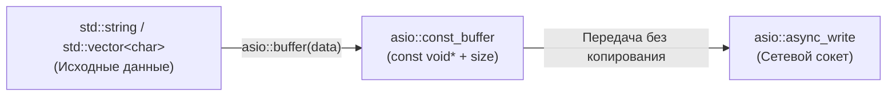

# 🌐 const_buffer

> [!abstract] Суть темы
> `boost::asio::const_buffer` — легковесное, неизменяемое представление (non-owning view) непрерывной последовательности байтов в памяти. Используется исключительно в операциях вывода (отправки данных: `async_write`, `write`, `send`).

---

## 🧠 Ключевые концепции и Жизненный цикл
*Связанные темы:* 
- [[buffers]],
- [[async_write]]

### 🔄 Потоковая модель и Контекст выполнения
- **Потокобезопасность:** Передача экземпляра `const_buffer` по значению тривиальна, однако параллельное изменение исходного контейнера во время передачи приводит к гонке данных.



---

## 💻 Сигнатуры и Код (MRE)

### Минимальный рабочий пример (Minimal Reproducible Example)
```cpp
#include <boost/asio.hpp>
#include <iostream>
#include <string>
#include <vector>
#include <array>

namespace asio = boost::asio;

int main() {
    const std::string header = "HEADER:LEN=12;";
    const std::string body = "Hello, World!";

    // 1. Создание через свободную функцию
    asio::const_buffer b1 = asio::buffer(header);

    // 2. Доступ к сырым данным
    const void* ptr = b1.data();
    std::size_t size = b1.size();
    std::cout << "Буфер размером " << size << " байт по адресу " << ptr << '\n';

    // 3. Арифметика буферов (срез/смещение)
    // Оператор '+' смещает указатель вправо и уменьшает size
    asio::const_buffer sliced = b1 + 7; // Пропускаем первые 7 байт ("HEADER:")

    // 4. Gather Write (составная последовательность)
    // Asio отправит оба буфера вместе без предварительной конкатенации строк
    std::array<asio::const_buffer, 2> composite_buffer = {
        asio::buffer(header),
        asio::buffer(body)
    };

    std::cout << "Суммарный размер составного буфера: " 
              << asio::buffer_size(composite_buffer) << " байт\n";

    return 0;
}
```

### 📋 Важные перегрузки и операторы
- **`data()`:** Возвращает `const void*` на начало области памяти.
- **`size()`:** Возвращает размер буфера в байтах (`std::size_t`).
- **`operator+ (const_buffer, std::size_t n)`:** Возвращает новый `const_buffer`, сдвинутый на `n` байт вперед (размер уменьшается на `n`). Удобно при частичной отправке данных.
- **Неявное приведение:** `asio::mutable_buffer` неявно приводится к `asio::const_buffer` (память, доступную для записи, всегда можно безопасно прочитать). Обратное приведение невозможно без `const_cast`.
---

## ⚠️ Подводные камни и Управление памятью (Gotchas)

> [!danger] Время жизни объектов (Lifetime Issues)
> - **Захват временных объектов (rvalues):**
> ```cpp
> // UB! Временный объект std::string сразу уничтожается
> asio::const_buffer b = asio::buffer(std::string("Temporary"));
> ```
  > Запрещено создавать `asio::buffer()` от временных строк, возвращаемых функциями по значению.
> - **Преобразование `std::string_view`:** Начиная с C++17 можно безопасно писать `asio::buffer(std::string_view(sv))`, но время жизни строки, на которую ссылается `view`, должно покрывать весь асинхронный вызов.
> - **Перемещение контейнера:** Если вызвать `std::move(source_string)` после формирования `const_buffer`, указатель внутри `const_buffer` станет инвалидным.
---

### 🚀 Способы интеграции / Асинхронные парадигмы
- [ ] **Использование в `async_write`:** Передаётся аргументом функции в качестве источника данных.
- [ ] **Gather Output:** Передача массивов `std::array<asio::const_buffer, N>` в функции записи исключает аллокации для склеивания пакетов.

---

## 🔗 Источники и Референсы
- 📖 [Boost.Asio Reference: const_buffer](https://www.boost.org/doc/libs/release/doc/html/boost_asio/reference/const_buffer.html)
- 📖 [Boost.Asio Concepts: ConstBufferSequence](https://www.boost.org/doc/libs/release/doc/html/boost_asio/reference/ConstBufferSequence.html)