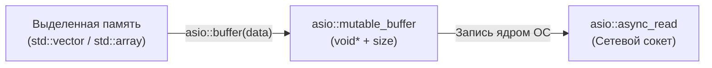

# 🌐 mutable_buffer

> [!abstract] Суть темы
> `boost::asio::mutable_buffer` — легковесное, модифицируемое представление (non-owning view) непрерывной области сырой памяти. Используется исключительно в операциях ввода (чтения и приёма данных: `async_read`, `async_read_some`, `receive`).

---

## 🧠 Ключевые концепции и Жизненный цикл
*Связанные темы:* 
- [[buffers]],
- [[async_read]]

### 🔄 Потоковая модель и Контекст выполнения
- **Неявная конверсия:** Любой `mutable_buffer` автоматически и неявно преобразуется в `const_buffer`. Это безопасно: память, открытую для записи, всегда можно прочитать.



---

## 💻 Сигнатуры и Код (MRE)

### Минимальный рабочий пример (Minimal Reproducible Example)
```cpp
#include <boost/asio.hpp>
#include <iostream>
#include <vector>
#include <array>

namespace asio = boost::asio;

int main() {
    // 1. Контейнер ОБЯЗАН быть неконстантным и заранее аллоцированным
    std::vector<char> storage(128); // Выделяем 128 байт под чтение

    // 2. Создание изменяемого буфера
    asio::mutable_buffer mb = asio::buffer(storage);

    void* raw_ptr = mb.data();
    std::size_t capacity = mb.size();
    std::cout << "Выделено под запись: " << capacity << " байт\n";

    // 3. Арифметика смещения (дозапись в хвост буфера)
    std::size_t bytes_already_read = 28;
    // Оператор '+' сдвигает указатель вправо и уменьшает доступный размер
    asio::mutable_buffer remaining = mb + bytes_already_read;
    std::cout << "Осталось места: " << remaining.size() << " байт\n";

    // 4. Scatter-Input (чтение заголовка фиксированного размера и тела)
    struct PacketHeader { uint32_t id; uint32_t size; } header;
    std::vector<char> payload(256);

    std::array<asio::mutable_buffer, 2> scatter_buffer = {
        asio::buffer(&header, sizeof(header)),
        asio::buffer(payload)
    };

    std::cout << "Суммарная емкость scatter-буфера: "
              << asio::buffer_size(scatter_buffer) << " байт\n";

    return 0;
}
```

### 📋 Важные перегрузки и операторы
- **`data()`:** Возвращает неконстантный указатель `void*` на начало области памяти.
- **`size()`:** Возвращает доступный для записи объем в байтах (`std::size_t`).
- **`operator+ (mutable_buffer, std::size_t n)`:** Возвращает новый `mutable_buffer`, сдвинутый на `n` байт вперед (размер уменьшается на `n`). Используется в циклах `read_some` для последовательного заполнения массива.
- **Неявное приведение:** `asio::mutable_buffer` неявно приводится к `asio::const_buffer` (память, доступную для записи, всегда можно безопасно прочитать). Обратное приведение невозможно без `const_cast`.
---

## ⚠️ Подводные камни и Управление памятью (Gotchas)

> [!danger] Время жизни объектов (Lifetime Issues)
>- **Пустой контейнер (`size == 0`):**
> ```cpp
> // Ничего НЕ прочитается
> std::vector<char> vec; // capacity может быть любым, но size == 0
> asio::async_read(socket, asio::buffer(vec), handler);
> // Операция завершится МГНОВЕННО, прочитав 0 байт
> ```
> - `asio::buffer()` смотрит на `size()`, а не на `capacity()`. Перед чтением контейнер обязан быть явно инициализирован нужным размером: `vec.resize(N)`.
> - **Чтение в `std::string` до C++11:** В старых стандартах непрерывность памяти `std::string` не гарантировалась. В C++11 и новее память непрерывна, поэтому в неконстантный `std::string` с ненулевым размером читать безопасно.
> - **Инвалидация при параллельном доступе:** Категорически запрещено читать или изменять контейнер в одном потоке, пока он передан в виде `mutable_buffer` асинхронной операции в другом потоке.
---

### 🚀 Способы интеграции / Асинхронные парадигмы
- [ ] **Использование в `async_read` / `async_read_some`:** Служит приемником сырых байтов из сокета.
- [ ] **Паттерн ручного дозаполнения (Chunked Read):**
  ```cpp
  // Итеративное заполнение буфера
  auto buf = asio::buffer(storage);
  std::size_t total = 0;
  while (total < storage.size()) {
      total += socket.read_some(buf + total);
  }
  ```
---

## 🔗 Источники и Референсы
- 📖 [Boost.Asio Reference: mutable_buffer](https://www.boost.org/doc/libs/release/doc/html/boost_asio/reference/mutable_buffer.html)
- 📖 [Boost.Asio Concepts: MutableBufferSequence](https://www.boost.org/doc/libs/release/doc/html/boost_asio/reference/MutableBufferSequence.html)