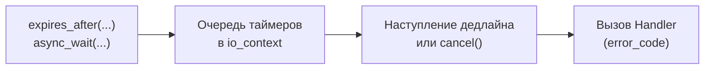

# 🌐 steady_timer

> [!abstract] Суть темы
> boost::asio::steady_timer - базовый асинхронный таймер на основе системных часов std::chrono::steady_clock
> Используется для отложенного запуска задач, периодических тиков и реализации сетевых таймаутов (heartbeats/deadlines).

---

## 🧠 Ключевые концепции и Жизненный цикл
*Связанные темы:* 
- [[io_context]], 
- [[error_code]],
- [[use_awaitable]]

### 🔄 Потоковая модель и Контекст выполнения
- **Потокобезопасность:** Не является потокобезопасным.
- **Executor:** Наследует исполнителя переданного при инициализации `io_context`



---

## 💻 Сигнатуры и Код (MRE)

### Минимальный рабочий пример
```cpp
#include <boost/asio.hpp>
#include <iostream>
#include <chrono>

namespace asio = boost::asio;
using namespace std::chrono_literals;

// 1. Подход на корутинах C++20
asio::awaitable<void> run_coroutine_timer(asio::io_context& io) {
    asio::steady_timer timer(io);
    timer.expires_after(200ms);

    std::cout << "[Coroutine] Ожидание таймера...\n";
    // Приостанавливает выполнение без блокировки потока
    co_await timer.async_wait(asio::use_awaitable);
    std::cout << "[Coroutine] Таймер сработал!\n";
}

int main() {
    try {
        asio::io_context io;

        // 2. Классический подход на колбэках
        asio::steady_timer cb_timer(io, 100ms);
        cb_timer.async_wait([](const boost::system::error_code& ec) {
            if (!ec) {
                std::cout << "[Callback] Таймер сработал!\n";
            }
        });

        // Запуск корутины
        asio::co_spawn(io, run_coroutine_timer(io), asio::detached);

        io.run();
    } catch (const std::exception& e) {
        std::cerr << "Исключение: " << e.what() << '\n';
    }
    return 0;
}
```

### 📋 Важные перегрузки и параметры
- **`expires_after(duration)`:** Устанавливает дедлайн относительно текущего момента (например, `100ms`, `5s`).
- **`expires_at(time_point)`:** Устанавливает абсолютный дедлайн по часам `steady_clock`.
- **`cancel()`:** Отменяет все ожидающие операции `async_wait()`. Возвращает количество отменённых операций.
- **`async_wait(token)`:** Принимает completion handler с сигнатурой `void(boost::system::error_code)`.
---

## ⚠️ Подводные камни и Управление памятью (Gotchas)

> [!danger] Время жизни объектов (Lifetime Issues)
> - **Отмена не отменяет вызов хэндлера:**
  Вызов `timer.cancel()` не удаляет хэндлер молча — он гарантированно **вызывается**, но с ошибкой `boost::asio::error::operation_aborted`. 
  > **Правило:** Внутри любого обработчика таймера первой строкой всегда проверяйте `if (ec == asio::error::operation_aborted) return;`. 
> - **Сброс дедлайна неявно отменяет прошлый вызов:** 
  Если вызвать `timer.expires_after(...)`, когда на таймере уже висит ожидающий `async_wait()`, этот предыдущий `async_wait()` немедленно завершится с `operation_aborted`. 
> - **Время жизни:** 
>   Объект таймера должен жить до тех пор, пока не завершится `async_wait()`. Уничтожение таймера раньше времени приводит к аварийной отмене оператора.
---

## ⚙️ Практические сценарии (Use Cases)

### 🚀 Способы интеграции / Асинхронные парадигмы
- [ ] **Callbacks:** 
      Базовый вариант с передачей лямбд. 
- [ ] **C++20 Coroutines:** 
      `co_await timer.async_wait(asio::use_awaitable)`. 
- [ ] **Паттерн Периодического таймера (Ticker):**
      Повторный вызов `timer.expires_after()` и `timer.async_wait()` прямо внутри тела обработчика для циклического повторения.
---

## 🔗 Источники и Референсы
- 📖 [Boost.Asio Documentation: steady_timer](https://www.boost.org/doc/libs/release/doc/html/boost_asio/reference/steady_timer.html)
- 🗺️ Карта знаний: [[MOC_Boost_Asio]]