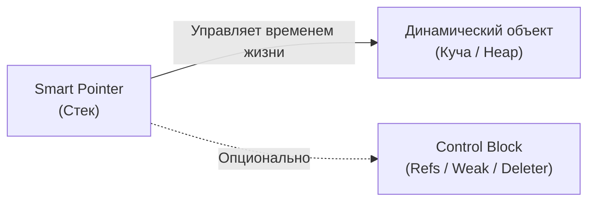

# 🌐 <% tp.file.title %>

> [!abstract] Суть темы
> Краткое описание назначения компонента и типа владения ресурсом в 1–2 предложениях.

---

## 🧠 Семантика владения и Характеристики памяти
- **Связанные темы:** [[RAII]], [[move_semantics]], [[custom_deleters]], [[pimpl_idiom]]
- **Модель владения:** [Эксклюзивное (Unique) | Разделяемое (Shared) | Не владеющее (Weak)]
- **Копирование и Перемещение:**
  - Копирование: [Запрещено | Разрешено (инкремент счетчика ссылок)]
  - Перемещение: [Move-only (`noexcept`) | С обнулением исходного указателя]
- **Оверхед по памяти и производительности:**
  - Размер на стеке: [Zero-overhead (`sizeof(T*)`) | Двойной указатель (`2 * sizeof(void*)`)]
  - Дополнительные аллокации: [Нет | Контрольный блок (Control Block) в куче]

### 🔄 Потоковая модель и Безопасность
- **Потокобезопасность самого указателя:** Безопасна ли параллельная модификация объекта указателя?
- **Потокобезопасность управляемого объекта:** Защищает ли умный указатель доступ к полям `T*`? (Спойлер: нет, нужен мьютекс).
- **Счетчик ссылок (Ref count):** Является ли атомарным (`std::atomic`)?



---

## 💻 Сигнатуры и Код (MRE)
*Минимальный рабочий пример (Minimal Reproducible Example):*

```cpp
#include <iostream>
#include <memory>
#include <utility>

struct Resource {
    Resource() { std::cout << "Resource created\n"; }
    ~Resource() { std::cout << "Resource destroyed\n"; }
    void do_work() const { std::cout << "Working...\n"; }
};

int main() {
    // 1. Предпочтительный способ создания (make_*)
    
    // 2. Использование и разыменование (*, ->)
    
    // 3. Передача владения / перемещение
    
    return 0;
}
```

### 📋 Важные функции, методы и параметры
- **Фабричная функция (`std::make_*`):** Плюсы использования против прямого `new` (исключительная безопасность, объединение аллокаций).
- **`get()`:** Получение сырого указателя `T*`. Правило: никогда не удалять и не передавать в другой умный указатель.
- **`reset()` / `release()`:** Разница между немедленным уничтожением ресурса и отказом от владения без вызова деструктора.
- **Кастомный делитор (Deleter):** Способ передачи кастомного освобождения (`fclose`, `free`, лямбда) и его влияние на тип указателя.

---

## ⚠️ Подводные камни и Управление памятью (Gotchas)
- **Множественные независимые владельцы:** Создание двух умных указателей из одного сырого адреса `T*` приводит к двойному освобождению памяти (`double free`).
- **Разыменование после перемещения (Use-After-Move):** Обращение к объекту через `operator->` после `std::move` приводит к разыменованию `nullptr`.
- **Циклические зависимости (Circular References):** Взаимное удержание через разделяемые указатели ведет к утечке памяти (решение: `std::weak_ptr`).
- **Неполные типы (Incomplete Types) и Pimpl:** Для типов вроде `std::unique_ptr` деструктор объемлющего класса обязан быть определен в `.cpp`, где тип `T` полностью известен.

---

## ⚙️️ Практические сценарии (Use Cases)
- [ ] Передача ресурса в функцию по значению (Sink-параметр для забора владения).
- [ ] Фабричный метод (возврат созданного ресурса из функции).
- [ ] Оборачивание Си-библиотек и системных дескрипторов (деструкторы сокетов, файлов `FILE*`).
- [ ] Реализация идиомы Pimpl (Pointer to Implementation).

---

## 🔗 Источники и Референсы
- 📖 [cppreference: <% tp.file.title %>](https://en.cppreference.com/)
- 🗺️ Карта знаний: [[MOC_C++_Memory_Management]]